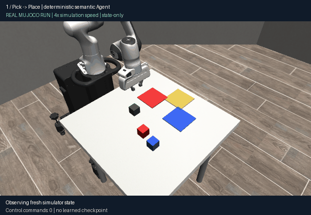
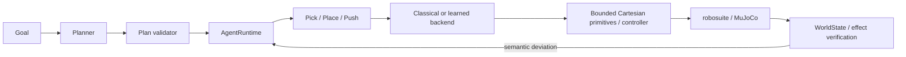

# Semantic Manipulation Stack

**How can task-level reasoning, bounded robot skills, and learned motor policies
share one execution loop without confusing motion completion with task success?**

An ongoing engineering/research project in a fixed MuJoCo / robosuite tabletop
scene with a Franka Panda. It connects validated plans to Pick, Place, and Push,
then verifies semantic outcomes from fresh simulator ground truth. This is not
a completed general-purpose robot Agent or a real-arm deployment.

**Implemented:** Pick/Place/Push, bounded skills, semantic verification and replanning.
**Evidence:** nominal 20/20 each; learned Push is a fixed-state diagnostic.

[Quick start](#quick-start) · [Results and evidence](#results-and-evidence) ·
[Reproduction guide](docs/reproducing.md) · [Architecture](docs/architecture.md)



**Real simulation, 4× playback (~34 s):** Pick→Place; an explicitly injected cube
movement after Pick, followed by one Agent replan; Classical Push to `right_side`.
Each clip ends with a semantic outcome check. The recovery is a controlled test
event, not an observed natural failure. No learned weights or LLM are used.
[Capture command and provenance](docs/reproducing.md#record-the-demo) ·
[Full result traces](docs/media/semantic-stack.json)

## Architecture



The system implements structured Goal/Plan validation, hierarchical skills with
bounded local recovery, explicit world interventions, semantic effect
verification, and event-triggered replanning. Push execution backends share one
`PushBackend` contract. The 20 Hz demonstration pipeline and matched
comparisons retain negative results alongside successful sequence-policy
experiments.

## What is implemented

- **Pick / Place:** finite-state skills, bounded grasp/release retries, and
  physical outcome verification through `SkillExecutor`.
- **Semantic Agent:** deterministic planner, strict validation, fresh-state
  effect checks, bounded replanning, and occupied-target skill composition.
  An optional LLM planner adapter exists; the results below use no LLM.
- **Classical Push:** Cartesian finite-state execution for the single public
  `right_side` region, with displacement, region, and on-table checks.
- **Experimental learned Push:** ACT queue / native Temporal Ensemble and
  state-based Diffusion Policy behind the same primitive/controller limits.
  One-step BC, Progress BC, and Chunk BC remain diagnostic baselines.

[Detailed contracts](docs/architecture.md) · [Dynamic-world scenarios](docs/dynamic_playground.md) ·
[Milestone history](docs/milestones.md)

## Quick start

Python 3.11 recommended; package metadata allows `>=3.10,<3.13`. The current
validation host is macOS ARM64; other platforms are not validated here.

```bash
git clone https://github.com/Block-O2/semantic-manipulation-stack.git
cd semantic-manipulation-stack
python3.11 -m venv .venv
source .venv/bin/activate
python -m pip install -e '.[dev]'
python -m pytest -q

# Fully local, no checkpoint / API key / display required
python -m demos.semantic_agent --no-render --inspect-seconds 0
python -m demos.push_test --no-render --inspect-seconds 0
python -m demos.semantic_agent --no-render --inspect-seconds 0 --disturbance object-lost
```

Core constraints: `robosuite==1.5.2`, `mujoco>=3.3,<3.4`, `numpy>=1.24,<2`.
Base tests skip the two optional ACT/Diffusion test modules when their packages
are absent. The existing learned environment passes the full suite, but a fresh
ACT extra install currently has a NumPy dependency conflict; see the
[installation limits](docs/reproducing.md#optional-learning-dependency-status).

On macOS, use `mjpython -m demos.semantic_agent --inspect-seconds 2` for the
interactive viewer. `demos.dynamic_playground` pauses for terminal input even
with `--no-render`; use `python -m demos.dynamic_scenarios --scenario all` for
an unattended run. [Installation, GUI/headless checks, and limitations](docs/reproducing.md)

## Results and evidence

**Nominal checks rerun on 2026-11-05:** Pick→Place 20/20 (seed 47), full
rule-based Agent 20/20 (seed 59), Classical Push 20/20 (seed 127). These are
separate seeded protocols, not a common 60-state benchmark. Pick/Place and Agent
randomize cube positions in one fixed scene; Push rejects unstable initial
placements (14 rejections in this rerun). [Commands and saved trial records](docs/reproducing.md#nominal-evaluations)

**Historical matched Push diagnostic**, recounted from committed per-trial JSON:

| Physical Push implementation | Success | Evidence |
|---|---:|---|
| Classical FSM | 20/20 | [records](artifacts/chunk_bc/physical_comparison.json) |
| One-step BC | 0/20 | [records](artifacts/chunk_bc/physical_comparison.json) |
| Simple Chunk BC K=20/H=20 | 2/20 | [records](artifacts/chunk_bc/physical_comparison.json) |
| ACT queue K=32/H=8 | 0/20 | [records](artifacts/act_push/physical_comparison.json) |
| ACT native Temporal Ensemble K=32/H=1 | 20/20 | [records](artifacts/act_temporal_ensemble/physical_comparison.json) |
| State Diffusion To=2/Tp=16/Ta=8 | 20/20 | [records](artifacts/diffusion_push/physical_comparison.json) |

All rows share the same 20 dataset indices, recorded seeds, and initial cube
positions, with the same semantic success test. Four earlier candidates were
excluded as replay-unstable. **17 evaluated states originate from training
episodes and 3 from validation episodes: this is not a held-out generalization
benchmark.** The source dataset contains 50 successful classical demonstrations
(32,652 steps); failed expert executions are not retained as training episodes.

ACT queue and Temporal Ensemble reuse the same trained weights according to
the experiment report; the recorded ensemble checkpoint hash stayed unchanged.
Native Temporal Ensemble combines overlapping past chunk predictions. Diffusion
uses two observations, a 16-action prediction, and eight executed actions per
sample. The comparison changes complete inference formulations and does not
isolate one causal factor. These learned results concern **Push only**, not
learned Pick/Place or arbitrary manipulation.

No datasets or learned checkpoints are published in this repository. Inspecting
saved evidence works from a fresh clone; learned demos require local data
collection and training. Exact historical weights/results are not guaranteed by
retraining. [Training/evaluation prerequisites](docs/reproducing.md#learned-push-is-not-a-one-command-demo)

Run `python evaluation/audit_saved_results.py` to recount all nine retained
backend variants without installing simulation dependencies. See the
[evidence audit](docs/evidence_audit.md) and [experiment index](docs/experiments.md)
for sample selection, controls, failure distributions, and interpretation.

## Scope and limits

- Fixed tabletop geometry and state-only simulator ground truth; no visual
  perception, real robot, open-scene validation, or general task learning.
- Push supports only `right_side`; contact is a geometric proximity proxy.
  Motion is not obstacle-aware or force-controlled.
- Local skill retry and Agent-level replanning are distinct mechanisms. The
  recorded recovery demonstrates the latter under a scripted intervention.
- Learned targets pass finite/workspace/step limits and the shared Cartesian
  path; this is not a production or formally verified safety guarantee.
- Historical Diffusion CPU sampling averaged 244 ms per call versus a 50 ms
  simulation control period; simulation success does not establish real-time
  deployment. No matched ACT latency comparison was recorded.
- M0–M7.6 are documented milestones; M8/execution monitoring has not started.

## Repository guide

| Area | Entry points |
|---|---|
| Scene and execution | `sim/`, `robot/`, `primitives/`, `skills/` |
| Task reasoning and state | `planner/`, `runtime/`, `world/`, `playground/` |
| Learning and evaluation | `datasets/`, `learning/`, `evaluation/`, `analysis/` |
| Runnable examples and tests | `demos/`, `tests/` |
| Evidence and documentation | `artifacts/`, `docs/` |

The earlier README mentioned a local `side_projects/agent_act_reproduction/`
project; it is not tracked in this public repository and is not a reproducible
component of the main stack. Historical implementation reports remain in
`docs/`.

## Third-party sources and licensing

MuJoCo and robosuite supply simulation, robot assets, and OSC control; ACT uses
Hugging Face **LeRobot 0.4.4** and its native Temporal Ensemble; the Diffusion
backend adapts the **Stanford Diffusion Policy** conditional U-Net with Hugging
Face `diffusers`. See [third-party notices and source attribution](docs/third_party_notices.md);
there is no repository-wide LICENSE for the author's original code.
